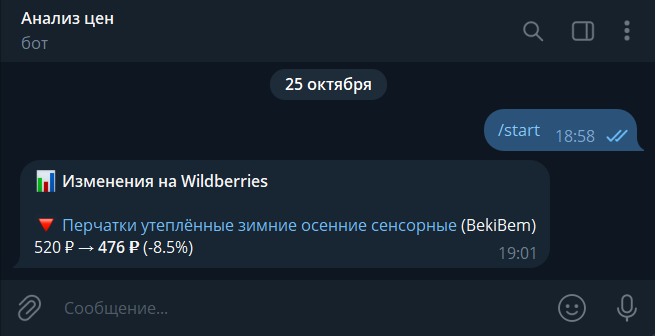
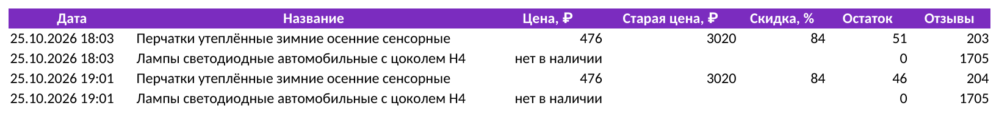

# 📊 WB Price Monitor

Мониторинг цен и наличия товаров на Wildberries с уведомлениями
в Telegram и историей в Excel или Google Таблицах. Подходит селлерам для отслеживания
конкурентов: вы задаёте список артикулов, скрипт регулярно проверяет
их и сообщает, когда цена изменилась или товар закончился.

<p align="center">
  
</p>

## ✨ Возможности

- **Цена, скидка, остатки, рейтинг и отзывы** по любому количеству артикулов
- **Уведомления в Telegram:** изменение цены (с процентом), «закончился», «снова в наличии»
- **Порог срабатывания:** например, сообщать только об изменениях от 5%
- **История в Excel:** каждая проверка дописывается строкой, удобно строить графики
- **Google Таблицы:** та же история онлайн, можно открыть с телефона или дать доступ коллегам
- **Артикулы или ссылки:** в `articles.txt` можно вставлять ссылки на товары прямо из браузера
- **Регион доставки** настраивается: цены и остатки на WB зависят от региона


<sub>Фрагмент Excel-отчёта: в полной версии также артикул, бренд, продавец, рейтинг и ссылка на товар.</sub>

## 🛡 Работа с антибот-защитой

Wildberries защищает внутренний API: без прохождения JS-проверки сервер
отвечает `498`/`403`, поэтому простые парсеры на `requests` и публичный
`card.wb.ru` из старых туториалов больше не работают.

Что удалось выяснить анализом трафика:

- данные карточки отдаёт эндпоинт `/__internal/u-card/cards/v4/detail`;
- после проверки браузер получает подписанный токен `x_wbaas_token`,
  **привязанный к IP и точному User-Agent**, со сроком жизни около 36 часов;
- сервер сверяет согласованность User-Agent, client hints (`sec-ch-ua*`)
  и служебных заголовков фронтенда (`deviceid`, `x-spa-version` и др.).

Как это решено:

1. **Честное прохождение проверки.** Playwright открывает товар в установленном
   Google Chrome с постоянным профилем, без подмены User-Agent.
2. **Перехват настоящего запроса.** Скрипт запоминает заголовки и куки,
   с которыми сайт сам обращается к API. Ничего не прописано вручную,
   поэтому обновления фронтенда WB подхватываются автоматически.
3. **Кэш сессии.** Браузер нужен примерно раз в полтора дня, остальные
   проверки идут лёгкими запросами через `curl_cffi` с TLS-отпечатком Chrome.
4. **Самовосстановление.** При блокировке сессия обновляется, а если и это
   не помогло, включается запасной режим: страницы товаров открываются
   в браузере и данные берутся из ответа самого сайта.

Запросы идут пачками с паузами, нагрузка на сайт минимальна.

## ▶️ Запуск

Нужны Python 3.10+ и Google Chrome.

```bash
git clone https://github.com/zara-engine/wb-price-monitor.git
cd wb-price-monitor
pip install -r requirements.txt
playwright install chromium   # запасной браузер, если Chrome не найден
```

Настройка:

1. Скопируйте `.env.example` в `.env` и заполните:
   - `TG_BOT_TOKEN` — токен бота от [@BotFather](https://t.me/BotFather);
   - `TG_CHAT_ID` — ваш id (можно узнать у [@userinfobot](https://t.me/userinfobot));
   - напишите своему боту `/start`, иначе он не сможет отправлять сообщения.
2. Впишите артикулы или ссылки на товары в `articles.txt`, по одному на строку.
3. По желанию подключите Google Таблицы (см. ниже).

Проверка:

```bash
python monitor.py --once                  # одна проверка
python monitor.py --interval 60           # проверять каждые 60 минут
python monitor.py --once --show-browser   # показать окно браузера (отладка)
```

Первый запуск запоминает текущие цены, уведомления приходят со второго.

## 📗 Google Таблицы

Скрипт пишет в таблицу от имени сервисного аккаунта Google: это
отдельный «робот»-пользователь, вход в ваш личный аккаунт не нужен.

1. Откройте [Google Cloud Console](https://console.cloud.google.com/)
   и создайте проект (или выберите существующий).
2. В разделе **APIs & Services → Library** включите **Google Sheets API**.
3. В **APIs & Services → Credentials** нажмите
   **Create credentials → Service account**, задайте любое имя и сохраните.
4. Откройте созданный аккаунт → вкладка **Keys** → **Add key → Create new key → JSON**.
   Скачанный файл переименуйте в `service_account.json` и положите в папку проекта
   (он уже в `.gitignore`, не публикуйте его).
5. Создайте Google Таблицу и нажмите **Настройки доступа**: добавьте email
   сервисного аккаунта (поле `client_email` в JSON, вида
   `…@….iam.gserviceaccount.com`) с правами **Редактор**.
6. Скопируйте ссылку на таблицу из адресной строки браузера и впишите в `.env`
   (вместо `<id>` в ней будет длинный набор букв и цифр):

   ```
   GOOGLE_SHEET=https://docs.google.com/spreadsheets/d/<id>/edit
   GOOGLE_CREDENTIALS=service_account.json
   ```

При следующей проверке в таблице появится лист «История цен» с шапкой,
и каждая проверка будет дописываться в него вместе с Excel. Если Google
недоступен, это попадёт в лог, а Excel и уведомления продолжат работать.
Если `GOOGLE_SHEET` пустой, выгрузка в Google отключена.

## 🗂 Структура

| Файл | Назначение |
|---|---|
| `wb_client.py` | сессия, антибот, запросы к API, разбор ответа |
| `storage.py` | сравнение с прошлой проверкой, Excel-история |
| `sheets.py` | выгрузка истории в Google Таблицы |
| `notifier.py` | уведомления в Telegram |
| `monitor.py` | точка входа, расписание проверок |

## 🔧 Адаптация

На базе проекта можно сделать мониторинг под конкретную задачу:
отслеживание всей категории или магазина конкурента, свои отчёты
в Google Таблицах, другие маркетплейсы, запуск на сервере 24/7.

📫 Telegram: [@stilian_zara](https://t.me/stilian_zara)
